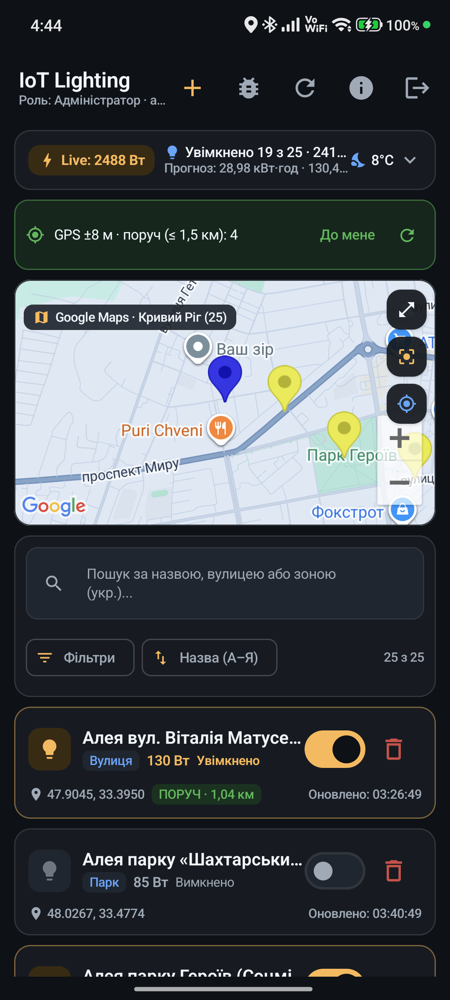
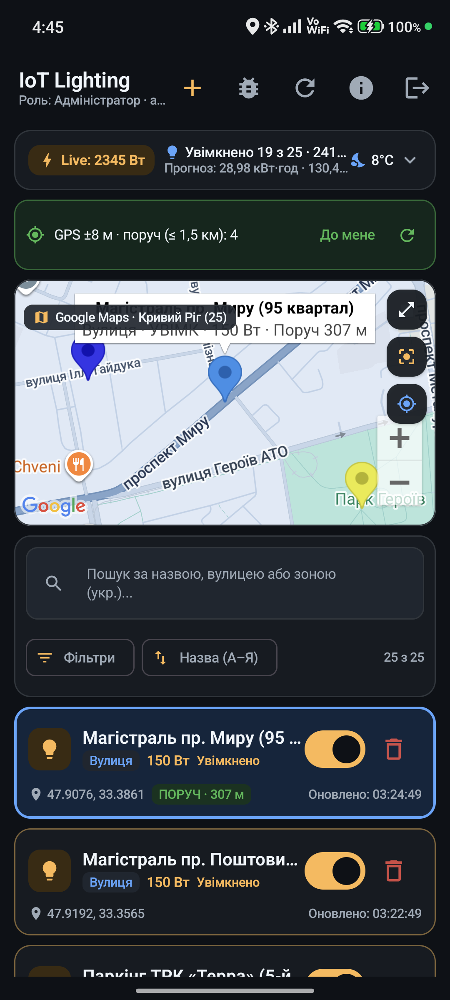
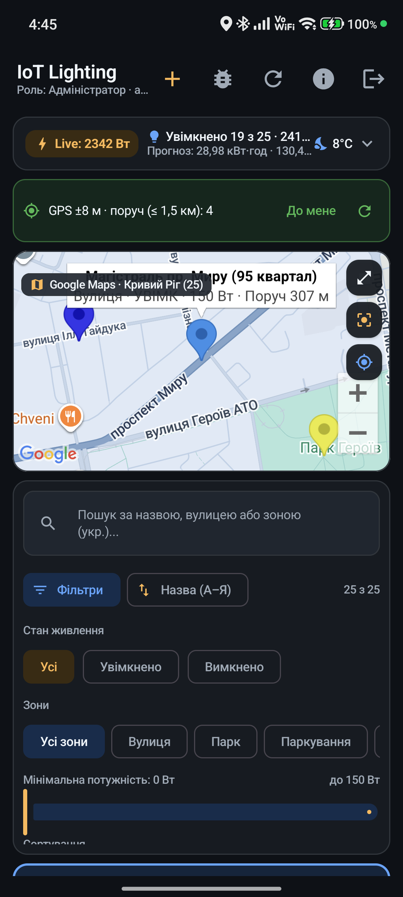
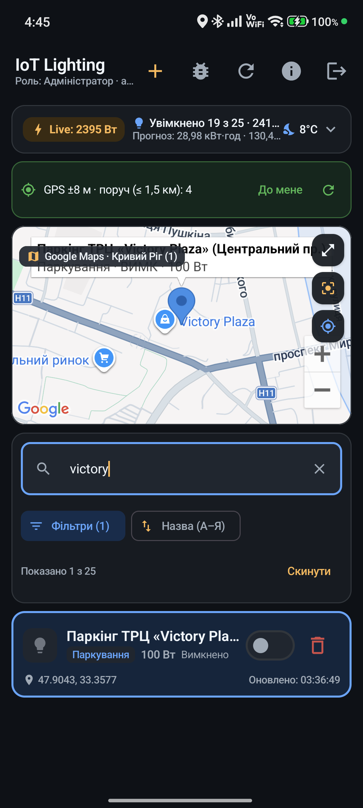
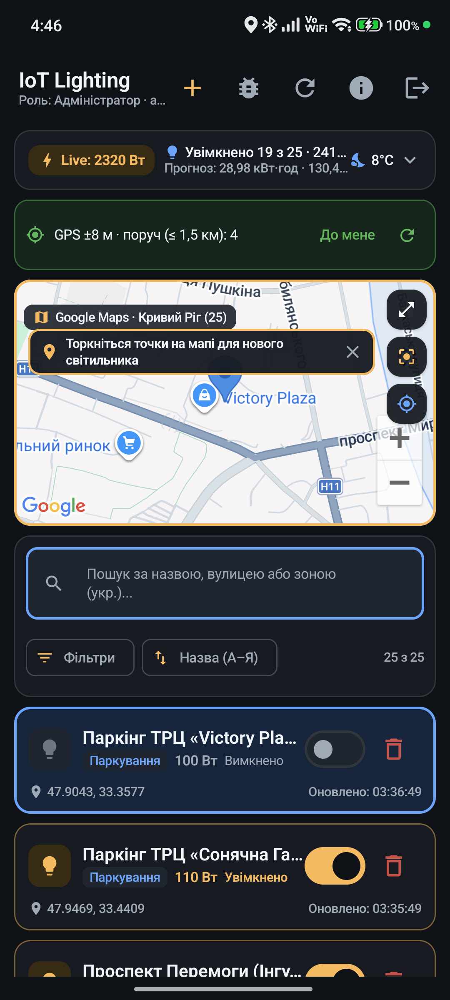
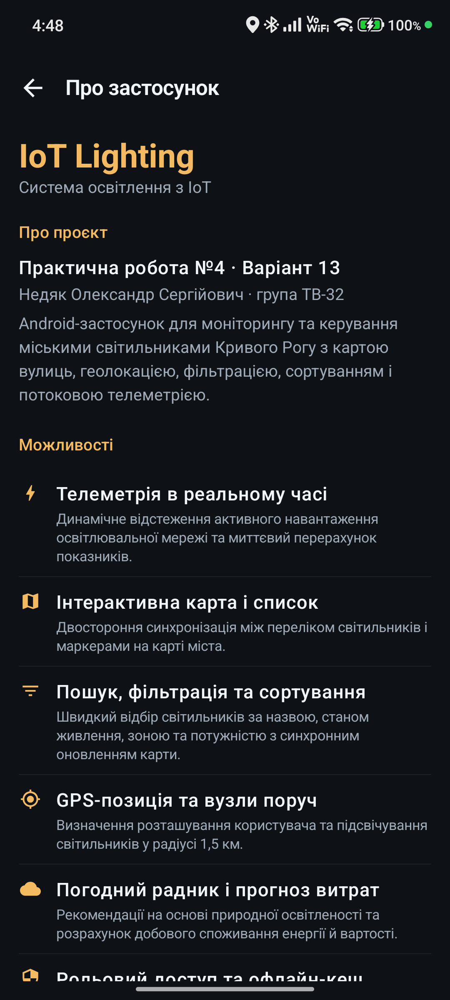

# КП4 (Варіант 13): Система освітлення з IoT — Просунутий рівень

Навчальний Android-застосунок `ua.kpi.iot_lighting.prac4` (minSdk 30, targetSdk 37) для моніторингу та керування міськими вузлами освітлення Кривого Рогу. Практичні заняття 13–16: реактивні потоки Flow, динамічні списки з географічною мапою, багаторівнева фільтрація й пошук, GPS із прив'язкою до реальних адрес.

## Реалізовані можливості (ПЗ13–ПЗ16)

- **ПЗ13 (Coroutines і Flow).** `combine` п'яти потоків у `DeviceListViewModel`: кеш Room, періодична погода Open-Meteo, GPS-позиція, гарячий `StateFlow` телеметрії `PowerSimulator` і стан фільтрів. Погода оновлюється кожні 5 хвилин, `retryWhen` робить дві спроби й віддає кеш при збої. Телеметрія змінюється кожні 3 секунди на ±5% від потужності увімкнених вузлів. Синхронізація повторюється, якщо кеш порожній, а `onAppResume` догружає дані після повернення на екран.
- **ПЗ14 (LazyColumn і мапа).** Список і `MapPanel` ділять один `selectedDeviceId`: тап по маркеру фокусує камеру, відкриває InfoWindow і прокручує `LazyColumn` до картки; тап по картці фокусує маркер. Google Maps SDK (`maps-compose`) працює з ключем із `local.properties`, без ключа вмикається запасна Canvas-мапа на тайлах OpenStreetMap.
- **ПЗ15 (фільтри, сортування, пошук).** Один незмінний `FilterSortState`: пошук за назвою або зоною з `debounce 250 мс`, стан живлення, зона, мінімальна потужність повзунком, три ключі сортування (назва, потужність, дата оновлення). Умови діють одночасно й синхронно оновлюють список і маркери. Порожні стани розрізняють завантаження, помилку синхронізації та відсутність збігів.
- **ПЗ16 (GPS і адреси).** Позиція через `FusedLocationProviderClient`, відстані за формулою гаверсинуса, коло й плашки «ПОРУЧ» у радіусі 1,5 км. Режим вибору точки на мапі повертає координати в діалог, `StreetGeocoder` робить пряме й зворотне геокодування через Nominatim і має офлайн-список 25 перевірених адрес. Відмова в дозволі не блокує застосунок: лишається кеш і банер із повторним запитом.

## Скріншоти

| | |
|---|---|
|  |  |
|  |  |
|  |  |

Повний комплект (16 кадрів) лежить у `docs/screenshots`.

## Технологічний стек

| Складова | Версія / рішення |
|---|---|
| Мова | Kotlin 2.2.10 |
| UI | Jetpack Compose (BOM 2026.02.01), Material 3, власна темна тема |
| Стан | Lifecycle ViewModel 2.11.0, StateFlow, `collectAsStateWithLifecycle` |
| Асинхронність | Kotlin Coroutines 1.10.2, Flow (cold і hot) |
| Дані | Room 2.8.5, KSP 2.2.10-2.0.2, експорт схеми в JSON |
| Мережа | Retrofit 3.0.0, Gson |
| Мапа | Google Maps maps-compose 6.2.1, play-services-maps 19.0.0 |
| Геолокація | play-services-location 21.3.0, FusedLocationProviderClient |
| Адреси | Nominatim (OpenStreetMap), без ключа |
| Збірка | AGP 9.4.1, Gradle 9.6.0, minSdk 30, compileSdk і targetSdk 37 |
| Тести | JUnit4, kotlinx-coroutines-test (37 модульних тестів) |

## Структура пакетів

```
app/src/main/java/ua/kpi/iot_lighting/prac4/
├── MainActivity.kt, Prac4Application.kt
├── data/      Room, Retrofit (сервер і Open-Meteo), авторизація, помилки, локація
├── domain/    моделі, репозиторії, GeoCalculator, LightingAdvisor, PowerSimulator
├── di/        AppContainer (без Hilt)
└── ui/        екрани входу, списку й About, MapPanel, StreetGeocoder, тема
```

## Запуск

```bat
:: 1. mock-сервер на порту 8081 (25 вузлів, Bearer-токен, режими збоїв)
run_server.bat

:: 2. прокинути порт на телефон (USB або Wi-Fi debugging)
adb reverse tcp:8081 tcp:8081
```

Для Google Maps додайте у `local.properties` (файл у `.gitignore`):

```properties
MAPS_API_KEY=ваш_ключ
```

Без ключа застосунок працює на запасній OSM-мапі, решта функцій не змінюється.

### Демо-акаунти

- **Адміністратор** (додавання, видалення, режим збоїв): `admin@light.io` / `admin123`
- **Користувач** (перегляд, фільтри, живлення): `user@light.io` / `user123`

Режим збоїв сервера перемикається кнопкою жука в топбарі адміністратора: штатний режим, повільна мережа, HTTP 500, 429, прострочений токен.

## Збірка й тести

```bat
gradlew.bat assembleDebug
gradlew.bat testDebugUnitTest
```

37 модульних тестів у 14 класах: фільтри й сортування, репозиторії, повтор запитів, погода, токен, мапери, обидві ViewModel і калькулятор відстаней.

## Обмеження

- Роль перевіряється на клієнті: mock-сервер валідує лише формат і термін дії Bearer-токена.
- Паролі демо-акаунтів зберігаються відкрито, це навчальний рівень.
- Nominatim приймає один запит на секунду, тому дистанційний пошук запускається кнопкою, а не на кожну літеру.
- Ключ Google Maps не комітиться й лежить лише в `local.properties`.
- Дані для демонстрації (25 адрес Кривого Рогу) підготовлені вручну й перевірені геокодером.

## Автор

Недяк Олександр Сергійович, група ТВ-32, НТУУ «КПІ ім. І. Сікорського», 2026.
Репозиторій: https://github.com/Bileneret/RPZMP_prac4
